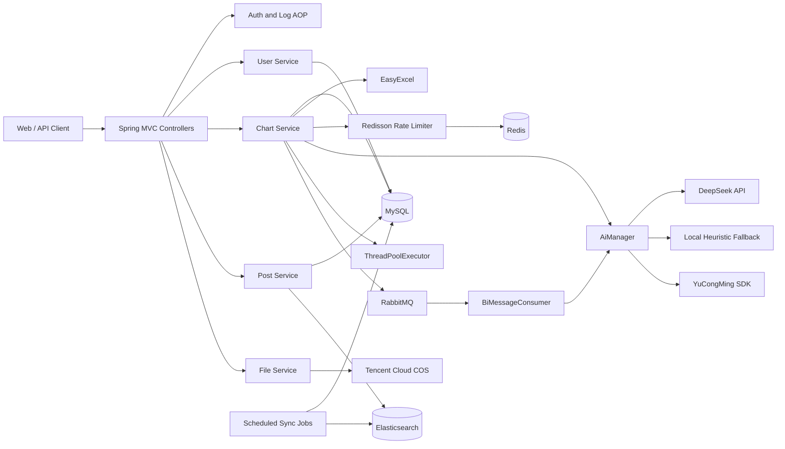

# AIGC Intelligent Data Analysis Platform Backend

English | [简体中文](README.md)

[](https://www.java.com/)
[](https://spring.io/projects/spring-boot)
[](https://baomidou.com/)
[](https://www.mysql.com/)
[](https://redis.io/)
[](https://www.rabbitmq.com/)
[](https://www.elastic.co/)
[](https://www.deepseek.com/)

A backend platform for AI-assisted analysis of Excel data. It converts spreadsheet content to CSV, calls a large language model to generate an ECharts configuration and a written analysis, and supports synchronous, thread-pool asynchronous, and RabbitMQ-based asynchronous execution.

> This repository contains the backend service only. A frontend application can integrate through the REST API exposed under `/api`.

## Overview

The platform is designed for the following workflow:

- Upload an Excel workbook and provide an analysis goal.
- Convert the workbook content into CSV.
- Generate an ECharts-compatible configuration and a Chinese analysis conclusion with an LLM.
- Persist the analysis record and expose pagination, editing, deletion, and status tracking.
- Move expensive AI calls out of the request thread through a thread pool or RabbitMQ.
- Apply per-user Redis rate limiting to cost-sensitive AI endpoints.

The codebase also includes user management, file upload, post management, likes, favorites, and Elasticsearch search modules. These modules demonstrate authentication, authorization, caching, messaging, object storage, and full-text search in a realistic Spring Boot application.

## Technology Stack

| Category | Technology | Version / Notes | Purpose |
| --- | --- | --- | --- |
| Runtime | Java | 8 | Backend runtime |
| Framework | Spring Boot | 2.7.2 | Auto-configuration, dependency management, embedded server |
| Web | Spring MVC | Managed by Spring Boot | REST APIs, multipart upload, sessions |
| AOP | Spring AOP / AspectJ | Managed by Spring Boot | Authorization and request logging |
| Persistence | MyBatis + MyBatis-Plus | 2.2.2 / 3.5.2 | SQL mapping, CRUD, pagination, logical deletion |
| Database | MySQL | 8.x | Users, charts, posts, and interactions |
| Cache | Redis + Redisson | Redisson 3.21.3 | Distributed rate limiting and optional Redis sessions |
| Messaging | RabbitMQ | AMQP Client 5.17.0 | Asynchronous AI jobs and manual acknowledgements |
| Search | Spring Data Elasticsearch | Managed by Spring Boot | Post search and index synchronization |
| AI | DeepSeek Chat Completions API | Configurable model | Chart generation and data analysis |
| AI compatibility | YuCongMing Java SDK | 0.0.2 | Legacy AI provider compatibility |
| Spreadsheet | Alibaba EasyExcel | 3.1.1 | Excel parsing and CSV conversion |
| Object storage | Tencent Cloud COS | 5.6.89 | Avatar and file upload |
| WeChat | WxJava | 4.4.0 | WeChat Official Account and Open Platform |
| API documentation | Knife4j / Springfox | 3.0.3 | Swagger 2 documentation and interactive testing |
| Templating | Freemarker | Managed by Spring Boot | Server-side templating support |
| Utilities | Hutool / Gson / Commons Lang3 | Managed by POM | HTTP, JSON, strings, and general utilities |
| Boilerplate reduction | Lombok | 1.18.46 | Logging and generated boilerplate |
| Build | Maven | 3.6+ | Dependency management and executable JAR |

## Core Capabilities

### AI Data Analysis

- Excel size limit: 1 MB.
- Synchronous analysis accepts `xlsx`; asynchronous analysis accepts `xls` and `xlsx`.
- Spreadsheet data is compacted into CSV before being sent to the AI provider.
- The response includes an ECharts V5 `option` JSON object and a written conclusion.
- Analysis records retain the goal, chart type, CSV data, generated output, and execution status.
- Supported statuses are `wait`, `running`, `succeed`, and `failed`.

### Execution Modes

| Mode | Endpoint | Behavior |
| --- | --- | --- |
| Synchronous | `POST /chart/gen` | Calls the AI provider and returns the final result in the request |
| Thread-pool asynchronous | `POST /chart/gen/async` | Returns a chart ID immediately and processes in the background |
| RabbitMQ asynchronous | `POST /chart/gen/async/mq` | Persists the job and publishes it to RabbitMQ |

### Users and Authorization

- Session-based authentication.
- Registration, login, logout, and current-user lookup.
- `user`, `admin`, and `ban` roles.
- Custom `@AuthCheck` annotation backed by Spring AOP.
- Salted password digests.

### Content and Search

- Post CRUD, pagination, personal post lists, and search.
- Post likes and favorites.
- Full and incremental MySQL-to-Elasticsearch synchronization.
- Elasticsearch-backed site search.

### Files and Infrastructure

- Tencent Cloud COS upload.
- Upload paths separated by business type and user ID.
- Global exception handling and a consistent response envelope.
- Request logging, timing, and request-chain identifiers.
- Redis-based per-user AI rate limiting at two requests per second by default.
- RabbitMQ examples for Direct, Fanout, Topic, TTL, and DLX patterns.

## Architecture



### AI Provider Resolution

`AiManager` resolves the AI provider in this order:

1. Use DeepSeek when `DEEPSEEK_API_KEY` is configured.
2. Use the local heuristic analyzer when DeepSeek is unavailable and `yuapi.client.local-fallback=true`.
3. Fall back to the YuCongMing SDK when neither condition applies.

The local fallback selects the first parseable numeric column, generates a line, bar, or pie chart based on the goal, and calculates the count, total, average, minimum, and maximum values.

## Data Model

| Table | Description |
| --- | --- |
| `user` | Account, password digest, display name, avatar, role, and logical deletion |
| `chart` | Goal, CSV input, chart type, ECharts output, conclusion, status, and execution message |
| `post` | Post content, tags, like count, and favorite count |
| `post_thumb` | Unique user-to-post like relationship |
| `post_favour` | Unique user-to-post favorite relationship |

The schema is defined in `sql/create_table.sql`. The Elasticsearch mapping is in `sql/post_es_mapping.json`.

## REST API

The default context path is `/api`. Under the local profile, the base URL is `http://localhost:8081/api`.

### Users

| Method | Path | Description |
| --- | --- | --- |
| `POST` | `/user/register` | Register a user |
| `POST` | `/user/login` | Log in |
| `POST` | `/user/logout` | Log out |
| `GET` | `/user/get/login` | Get the current user |
| `POST` | `/user/list/page/vo` | Paginated user list |
| `POST` | `/user/update/my` | Update the current profile |
| `POST` | `/user/add` | Add a user, admin only |
| `POST` | `/user/delete` | Delete a user, admin only |
| `POST` | `/user/update` | Update a user, admin only |

### Intelligent Charts

| Method | Path | Description |
| --- | --- | --- |
| `POST` | `/chart/gen` | Synchronous AI analysis |
| `POST` | `/chart/gen/async` | Thread-pool asynchronous analysis |
| `POST` | `/chart/gen/async/mq` | RabbitMQ asynchronous analysis |
| `GET` | `/chart/get` | Get a chart by ID |
| `POST` | `/chart/list/page` | Paginated chart list |
| `POST` | `/chart/my/list/page` | Current user's chart list |
| `POST` | `/chart/edit` | Edit a chart |
| `POST` | `/chart/update` | Update a chart |
| `POST` | `/chart/delete` | Delete a chart |

### Posts and Interactions

| Method | Path | Description |
| --- | --- | --- |
| `POST` | `/post/add` | Create a post |
| `POST` | `/post/delete` | Delete a post |
| `POST` | `/post/update` | Update a post |
| `GET` | `/post/get/vo` | Get post details |
| `POST` | `/post/list/page/vo` | Paginated post list |
| `POST` | `/post/my/list/page/vo` | Current user's posts |
| `POST` | `/post/search/page/vo` | Elasticsearch post search |
| `POST` | `/post_thumb/` | Like or unlike a post |
| `POST` | `/post_favour/` | Favorite or unfavorite a post |

### Files and Queue Examples

| Method | Path | Description |
| --- | --- | --- |
| `POST` | `/file/upload` | Upload a file to COS |
| `GET` | `/queue/add` | Publish a RabbitMQ example message |
| `GET` | `/queue/get` | Receive a RabbitMQ example message |

Interactive API documentation:

```text
http://localhost:8081/api/doc.html
```

OpenAPI JSON:

```text
http://localhost:8081/api/v2/api-docs
```

## Project Layout

```text
.
├── doc/                         # Project documentation assets
├── scripts/                     # Windows local start and stop scripts
├── sql/                         # MySQL schema and Elasticsearch mapping
├── src/main/java/com/zzw/aigcdata/
│   ├── annotation/              # Custom annotations
│   ├── aop/                     # Authorization and logging aspects
│   ├── api/                     # AI provider adapters
│   ├── bizmq/                   # BI analysis RabbitMQ producer and consumer
│   ├── common/                  # Response envelope, error codes, pagination
│   ├── config/                  # MVC, Redis, MQ, ES, COS, and Swagger config
│   ├── constant/                # Shared constants
│   ├── controller/              # REST API endpoints
│   ├── esdao/                   # Elasticsearch repositories
│   ├── exception/               # Business and global exception handling
│   ├── job/                     # Full and incremental ES synchronization
│   ├── manager/                 # AI, COS, and rate-limiting infrastructure
│   ├── mapper/                  # MyBatis mappers
│   ├── model/                   # DTOs, entities, VOs, and enums
│   ├── mq/                      # RabbitMQ examples
│   ├── service/                 # Business services
│   └── utils/                   # Excel, network, SQL, and Spring utilities
├── src/main/resources/
│   ├── mapper/                  # MyBatis XML
│   └── application*.yml         # Environment-specific configuration
└── src/test/java/               # Unit and integration test examples
```

## Getting Started

### Prerequisites

- JDK 8
- Maven 3.6+
- MySQL 8.x
- Redis 5.x+
- RabbitMQ 3.x+
- Elasticsearch 7.x for full post search
- Windows PowerShell for the bundled local scripts

### Option 1: Standard Maven Startup

1. Create the database schema:

```bash
mysql -u root -p < sql/create_table.sql
```

2. Update MySQL, Redis, RabbitMQ, and Elasticsearch connection settings in `src/main/resources/application-local.yml` or the target environment profile.

3. Configure an AI key:

```powershell
$env:DEEPSEEK_API_KEY="your-deepseek-api-key"
```

4. Build and run:

```bash
mvn clean package -DskipTests
java -jar target/aigc-data-analysis-backend-0.0.1-SNAPSHOT.jar --spring.profiles.active=local
```

5. Open the API documentation:

```text
http://localhost:8081/api/doc.html
```

### Option 2: Windows Local Script

`scripts/start-local.ps1` starts a dedicated local MySQL data directory and the backend with the `local` profile. It also uses `subst` to map the non-ASCII project path to an ASCII drive letter.

```powershell
.\scripts\start-local.ps1
```

Stop the backend and local MySQL:

```powershell
.\scripts\stop-local.ps1
```

The script contains absolute paths for JDK, Maven, and MySQL near the top of the file. Update them before using the project on another machine.

The local script creates a development administrator:

```text
Username: admin
Password: admin123456
```

This account is for local development only and must be replaced outside local environments.

## Configuration

### Profiles

| Profile | Port | Datasource | Purpose |
| --- | --- | --- | --- |
| `dev` | `8080` | `localhost:3306/yubi` | Default development configuration |
| `local` | `8081` | `127.0.0.1:3307/yubi` | Project-specific local runtime |
| `test` | `8101` | `my_db` placeholder | Test environment template |
| `prod` | `8101` | `my_db` placeholder | Production environment template |

The datasource, Redis, and Elasticsearch values in `prod` and `test` are placeholders and must be replaced before deployment.

### Main Settings

| Setting | Description |
| --- | --- |
| `spring.datasource.*` | MySQL connection, username, and password |
| `spring.redis.*` | Redis connection and database index |
| `spring.rabbitmq.*` | RabbitMQ connection |
| `spring.elasticsearch.uris` | Elasticsearch endpoint |
| `spring.session.store-type` | Set to `redis` to enable Redis sessions |
| `ai.deepseek.base-url` | DeepSeek API base URL |
| `ai.deepseek.api-key` | DeepSeek API key |
| `ai.deepseek.model` | Model name, defaults to `deepseek-chat` |
| `yuapi.client.local-fallback` | Enables the local chart analyzer |
| `yuapi.client.access-key` | YuCongMing compatibility access key |
| `yuapi.client.secret-key` | YuCongMing compatibility secret key |
| `cos.client.*` | Tencent Cloud COS credentials, region, and bucket |
| `wx.mp.*` | WeChat Official Account settings |
| `wx.open.*` | WeChat Open Platform settings |

### Recommended Environment Variables

```text
DEEPSEEK_API_KEY
DEEPSEEK_BASE_URL
DEEPSEEK_MODEL
YUAPI_CLIENT_ACCESS_KEY
YUAPI_CLIENT_SECRET_KEY
```

Never commit real credentials, database passwords, or cloud-storage secrets.

## API Examples

### Login

```bash
curl -c cookies.txt \
  -H "Content-Type: application/json" \
  -d '{"userAccount":"admin","userPassword":"admin123456"}' \
  http://localhost:8081/api/user/login
```

### Synchronous Chart Generation

```bash
curl -b cookies.txt \
  -F "file=@sales.xlsx" \
  -F "goal=Analyze the monthly sales trend" \
  -F "chartType=柱状图" \
  http://localhost:8081/api/chart/gen
```

### Asynchronous Chart Generation

```bash
curl -b cookies.txt \
  -F "file=@sales.xlsx" \
  -F "goal=Analyze the monthly sales trend" \
  -F "chartType=折线图" \
  http://localhost:8081/api/chart/gen/async
```

The asynchronous endpoint returns a `chartId` immediately. Poll `GET /chart/get?id={chartId}` for status and generated output.

The local fallback analyzer uses Chinese chart type values such as `折线图`, `柱状图`, and `饼图`. Natural-language chart descriptions can also be passed when DeepSeek is enabled.

## Build, Test, and Deployment

### Build

```bash
mvn clean package
```

Artifact:

```text
target/aigc-data-analysis-backend-0.0.1-SNAPSHOT.jar
```

### Test

```bash
mvn test
```

The repository contains tests for AI, COS, Redis, Elasticsearch, MyBatis, services, and Excel utilities. Some tests require MySQL, Redis, RabbitMQ, Elasticsearch, or third-party credentials.

### Docker

A `Dockerfile` is included and starts with the `prod` profile by default. External MySQL, Redis, RabbitMQ, Elasticsearch, and AI service configuration is still required.

```bash
docker build -t aigc-data-analysis-backend .
```

## Reliability Design

- Global exception handling normalizes business and system errors.
- The request logging aspect records URI, HTTP method, duration, and result.
- Chart jobs explicitly track execution status and failure messages.
- The BI RabbitMQ queue is durable and uses manual acknowledgements.
- Elasticsearch synchronization failures are logged and retried by later scheduled runs.
- AI calls support DeepSeek, a local fallback, and a legacy provider.
- Rate limiting runs before the AI call to reduce accidental cost.

## Security Notes

- Passwords currently use a salted digest implementation for compatibility. Production deployments should migrate to BCrypt, Argon2, or SCrypt.
- Session cookies are configured for 30 days. Production deployments should combine HTTPS, SameSite, and secure-cookie policies.
- WeChat, COS, database, and AI credentials must not be committed to a public repository.
- `FileConstant.COS_HOST` must be replaced with the real object-storage domain.
- File uploads should be extended with content-type validation, malware scanning, and access control.
- Administrative endpoints are protected by `@AuthCheck`; new sensitive endpoints must apply equivalent checks.

## Troubleshooting

### API Documentation Is Not Available

- Confirm that the active profile is `dev` or `test`.
- Include the context path in the URL: `/api/doc.html`.
- Verify the actual server port from the startup log.

### AI Analysis Returns a System Error

- Verify that `DEEPSEEK_API_KEY` is configured.
- Check the DeepSeek base URL and model name.
- Inspect the backend log for the HTTP status and provider error.
- Set `yuapi.client.local-fallback=true` to use the local analyzer.

### Elasticsearch Synchronization Fails

- Check `spring.elasticsearch.uris`.
- Confirm that the `post_v1` index and mapping exist.
- Verify compatibility between Elasticsearch and Spring Data Elasticsearch.

### MySQL Fails Under a Non-ASCII Path

Windows MySQL installations may not handle non-ASCII paths reliably. The provided scripts map the project to an ASCII drive letter through `subst`.

## Recommended Next Steps

- Replace chart status strings with an enum or state machine.
- Add task timeouts, retries, dead-letter queues, and compensation.
- Introduce structured logging, metrics, and distributed tracing.
- Abstract AI providers behind a strategy interface for multi-model routing.
- Add resource-level authorization, audit logs, and sensitive-operation confirmation.
- Manage schema changes with Flyway or Liquibase.
- Add Redis caching and invalidation for high-frequency reads.

## Maintainer

`zzw`

---

Built as an extensible foundation for AI-assisted data analysis and enterprise Spring Boot services.
