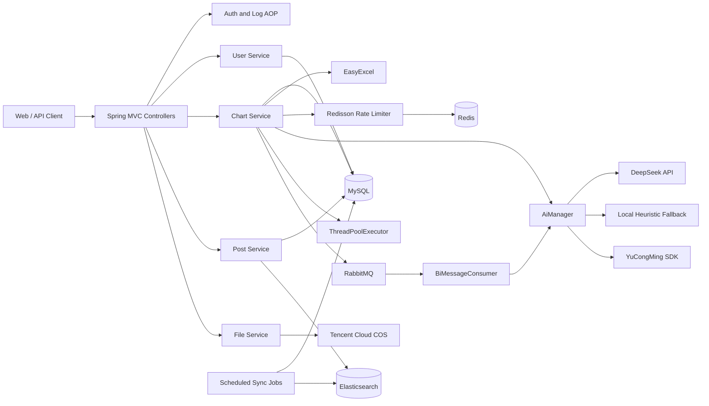

# AIGC 智能数据分析平台后端

[English](README.en.md) | 简体中文

[](https://www.java.com/)
[](https://spring.io/projects/spring-boot)
[](https://baomidou.com/)
[](https://www.mysql.com/)
[](https://redis.io/)
[](https://www.rabbitmq.com/)
[](https://www.elastic.co/)
[](https://www.deepseek.com/)

面向 Excel 数据文件的一站式智能分析后端。系统将表格数据转换为 CSV，调用大模型生成 ECharts 配置和分析结论，并支持同步、线程池异步和 RabbitMQ 异步三种任务执行模式。

> 本仓库同时包含根目录下的后端服务与 `frontend/` 目录下的 React 前端。前端通过 `/api` 下的 REST API 与后端交互。

前端文档：[简体中文](frontend/README.zh-CN.md) | [English](frontend/README.md)

## 前端应用

前端基于 **React、Umi Max、Ant Design、TypeScript 和 Apache ECharts** 构建，提供 AI 分析工作台、异步任务追踪、图表画廊和响应式移动端体验。

[简体中文 README](frontend/README.zh-CN.md) · [English README](frontend/README.md) · [查看前端源码](frontend/)
## 项目定位

AIGC 智能数据分析平台后端聚焦以下场景：

- 用户上传 Excel 文件并填写分析目标。
- 系统自动读取表格数据并转换为 CSV。
- 大模型返回可直接渲染的 ECharts 配置和中文分析结论。
- 分析记录持久化到 MySQL，并支持分页、编辑、删除和状态跟踪。
- 通过线程池或 RabbitMQ 将耗时 AI 调用从请求线程中解耦。
- 通过 Redis 对高成本 AI 接口执行用户级限流。

项目同时提供用户、文件、帖子、点赞、收藏和 Elasticsearch 搜索等基础模块，用于演示企业级后台系统常见的认证、权限、缓存、消息队列、对象存储和全文检索能力。

## 技术栈

| 分类 | 技术 | 版本或说明 | 用途 |
| --- | --- | --- | --- |
| 运行环境 | Java | 8 | 后端运行时 |
| 应用框架 | Spring Boot | 2.7.2 | 自动配置、依赖管理、内嵌 Web 容器 |
| Web | Spring MVC | Spring Boot 管理 | REST API、文件上传、Session |
| 切面 | Spring AOP / AspectJ | Spring Boot 管理 | 权限校验、统一请求日志 |
| 数据访问 | MyBatis + MyBatis-Plus | 2.2.2 / 3.5.2 | SQL 映射、通用 CRUD、分页、逻辑删除 |
| 数据库 | MySQL | 8.x | 用户、图表、帖子及互动数据 |
| 缓存与限流 | Redis + Redisson | Redisson 3.21.3 | 分布式限流、可选分布式 Session |
| 消息队列 | RabbitMQ | AMQP Client 5.17.0 | AI 分析任务异步解耦、手动确认 |
| 搜索引擎 | Spring Data Elasticsearch | Spring Boot 管理 | 帖子全文检索与同步索引 |
| AI | DeepSeek Chat Completions API | 可配置模型 | 图表配置与数据分析结论生成 |
| AI 兼容能力 | YuCongMing Java SDK | 0.0.2 | 兼容旧 AI Provider |
| 表格处理 | Alibaba EasyExcel | 3.1.1 | Excel 读取与 CSV 转换 |
| 对象存储 | Tencent Cloud COS | 5.6.89 | 用户头像等文件上传 |
| 微信 | WxJava | 4.4.0 | 微信公众平台和开放平台能力 |
| API 文档 | Knife4j / Springfox | 3.0.3 | Swagger 2 文档与在线调试 |
| 模板引擎 | Freemarker | Spring Boot 管理 | 服务端模板能力 |
| 工具库 | Hutool / Gson / Commons Lang3 | POM 管理 | HTTP、JSON、字符串与通用工具 |
| 简化代码 | Lombok | 1.18.46 | 构造器、日志和样板代码生成 |
| 构建 | Maven | 3.6+ | 依赖管理与可执行 JAR 打包 |

## 核心能力

### 智能数据分析

- Excel 文件大小限制为 1 MB。
- 同步接口接受 `xlsx`，异步接口接受 `xls` 和 `xlsx`。
- 自动将工作表内容压缩为 CSV 后发送给 AI。
- 输出包含 ECharts V5 `option` JSON 和自然语言分析结论。
- 分析记录保存原始目标、图表类型、CSV 数据、生成结果和执行状态。
- 支持 `wait`、`running`、`succeed`、`failed` 状态流转。

### 多种执行模式

| 模式 | 接口 | 特点 |
| --- | --- | --- |
| 同步 | `POST /chart/gen` | 请求内完成 AI 调用并立即返回结果 |
| 线程池异步 | `POST /chart/gen/async` | 先返回图表 ID，后台线程执行 |
| 消息队列异步 | `POST /chart/gen/async/mq` | 持久化任务后投递 RabbitMQ，消费者执行 |

### 用户与权限

- 基于 Session 的登录态管理。
- 账号密码登录、注册、注销和当前用户查询。
- `user`、`admin`、`ban` 三种角色。
- 通过自定义 `@AuthCheck` 注解和 AOP 实现管理员权限校验。
- 用户密码使用加盐摘要存储。

### 内容与搜索

- 帖子 CRUD、分页、个人帖子和搜索。
- 帖子点赞与收藏。
- MySQL 数据通过全量任务和每分钟增量任务同步到 Elasticsearch。
- 支持基于 Elasticsearch 的站内搜索。

### 文件与基础设施

- 腾讯云 COS 文件上传。
- 按业务类型和用户 ID 隔离上传目录。
- 全局异常处理和统一响应结构。
- 统一请求日志、耗时统计和请求链路标识。
- Redis 用户级限流：AI 分析接口默认每个用户每秒最多 2 次。
- 提供 RabbitMQ Direct、Fanout、Topic、TTL、DLX 示例代码。

## 系统架构



### AI Provider 选择顺序

`AiManager` 按以下顺序选择 AI 能力：

1. 配置 `DEEPSEEK_API_KEY` 时，优先调用 DeepSeek。
2. 未配置 DeepSeek 且 `yuapi.client.local-fallback=true` 时，使用本地基础图表分析。
3. 以上条件都不满足时，回退到 YuCongMing SDK。

本地兜底逻辑会识别 CSV 中的第一个可解析数值列，根据分析目标生成折线图、柱状图或饼图，并统计总数、平均值、最小值和最大值。

## 数据模型

| 表 | 说明 |
| --- | --- |
| `user` | 用户账号、密码摘要、昵称、头像、角色和逻辑删除标记 |
| `chart` | 分析目标、原始 CSV、图表类型、ECharts 配置、分析结论、状态和执行信息 |
| `post` | 帖子内容、标签、点赞数、收藏数 |
| `post_thumb` | 用户与帖子的唯一点赞关系 |
| `post_favour` | 用户与帖子的唯一收藏关系 |

建表脚本位于 `sql/create_table.sql`，Elasticsearch 映射位于 `sql/post_es_mapping.json`。

## REST API

默认上下文路径为 `/api`。本地配置下完整地址为 `http://localhost:8081/api`。

### 用户

| 方法 | 路径 | 说明 |
| --- | --- | --- |
| `POST` | `/user/register` | 用户注册 |
| `POST` | `/user/login` | 用户登录 |
| `POST` | `/user/logout` | 用户注销 |
| `GET` | `/user/get/login` | 获取当前登录用户 |
| `POST` | `/user/list/page/vo` | 用户分页列表 |
| `POST` | `/user/update/my` | 更新个人信息 |
| `POST` | `/user/add` | 新增用户，仅管理员 |
| `POST` | `/user/delete` | 删除用户，仅管理员 |
| `POST` | `/user/update` | 更新用户，仅管理员 |

### 智能图表

| 方法 | 路径 | 说明 |
| --- | --- | --- |
| `POST` | `/chart/gen` | 同步 AI 分析 |
| `POST` | `/chart/gen/async` | 线程池异步分析 |
| `POST` | `/chart/gen/async/mq` | RabbitMQ 异步分析 |
| `GET` | `/chart/get` | 根据 ID 查询图表 |
| `POST` | `/chart/list/page` | 图表分页列表 |
| `POST` | `/chart/my/list/page` | 当前用户图表列表 |
| `POST` | `/chart/edit` | 编辑图表 |
| `POST` | `/chart/update` | 更新图表 |
| `POST` | `/chart/delete` | 删除图表 |

### 帖子与互动

| 方法 | 路径 | 说明 |
| --- | --- | --- |
| `POST` | `/post/add` | 创建帖子 |
| `POST` | `/post/delete` | 删除帖子 |
| `POST` | `/post/update` | 更新帖子 |
| `GET` | `/post/get/vo` | 获取帖子详情 |
| `POST` | `/post/list/page/vo` | 帖子分页列表 |
| `POST` | `/post/my/list/page/vo` | 我的帖子 |
| `POST` | `/post/search/page/vo` | Elasticsearch 搜索 |
| `POST` | `/post_thumb/` | 点赞或取消点赞 |
| `POST` | `/post_favour/` | 收藏或取消收藏 |

### 文件与示例队列

| 方法 | 路径 | 说明 |
| --- | --- | --- |
| `POST` | `/file/upload` | 上传文件到 COS |
| `GET` | `/queue/add` | RabbitMQ 示例消息发送 |
| `GET` | `/queue/get` | RabbitMQ 示例消息接收 |

完整参数和响应模型请访问 Knife4j：

```text
http://localhost:8081/api/doc.html
```

OpenAPI JSON：

```text
http://localhost:8081/api/v2/api-docs
```

## 项目结构

```text
.
├── doc/                         # 项目图片与文档资源
├── scripts/                     # Windows 本地启动和停止脚本
├── sql/                         # MySQL 建表脚本与 ES 映射
├── src/main/java/com/zzw/aigcdata/
│   ├── annotation/              # 自定义注解
│   ├── aop/                     # 权限和日志切面
│   ├── api/                     # AI Provider 适配器
│   ├── bizmq/                   # BI 分析 RabbitMQ 生产者和消费者
│   ├── common/                  # 通用响应、错误码、分页模型
│   ├── config/                  # MVC、Redis、MQ、ES、COS、Swagger 配置
│   ├── constant/                # 公共常量
│   ├── controller/              # REST API
│   ├── esdao/                   # Elasticsearch Repository
│   ├── exception/               # 业务异常和全局异常处理
│   ├── job/                     # 全量和增量 ES 同步任务
│   ├── manager/                 # AI、COS、限流等基础能力
│   ├── mapper/                  # MyBatis Mapper
│   ├── model/                   # DTO、Entity、VO、Enum
│   ├── mq/                      # RabbitMQ 示例
│   ├── service/                 # 业务服务
│   └── utils/                   # Excel、网络、SQL 和 Spring 工具
├── src/main/resources/
│   ├── mapper/                  # MyBatis XML
│   └── application*.yml         # 多环境配置
└── src/test/java/               # 单元与集成测试示例
```

## 快速开始

### 环境要求

- JDK 8
- Maven 3.6+
- MySQL 8.x
- Redis 5.x+
- RabbitMQ 3.x+
- Elasticsearch 7.x，使用完整帖子搜索功能时需要
- Windows PowerShell，仅本地启动脚本需要

### 方式一：标准 Maven 启动

1. 创建数据库并导入表结构：

```bash
mysql -u root -p < sql/create_table.sql
```

2. 修改 `src/main/resources/application-local.yml` 或对应环境配置中的 MySQL、Redis、RabbitMQ、Elasticsearch 连接信息。

3. 配置 AI Key：

```powershell
$env:DEEPSEEK_API_KEY="your-deepseek-api-key"
```

4. 构建并启动：

```bash
mvn clean package -DskipTests
java -jar target/aigc-data-analysis-backend-0.0.1-SNAPSHOT.jar --spring.profiles.active=local
```

5. 访问接口文档：

```text
http://localhost:8081/api/doc.html
```

### 方式二：Windows 本地脚本

项目提供 `scripts/start-local.ps1` 和 `scripts/stop-local.ps1`。脚本会使用独立 MySQL 数据目录、启动 `local` profile 后端，并通过 `subst` 将中文路径映射到 ASCII 盘符。

```powershell
.\scripts\start-local.ps1
```

停止后端和本地 MySQL：

```powershell
.\scripts\stop-local.ps1
```

脚本顶部包含 JDK、Maven、MySQL 的绝对路径。迁移到其他电脑前，请先修改这些变量。

本地脚本默认创建管理员账号：

```text
账号：admin
密码：admin123456
```

该账号仅用于本地开发，非本地环境必须更换。

## 环境配置

### Profile

| Profile | 端口 | 数据源 | 用途 |
| --- | --- | --- | --- |
| `dev` | `8080` | `localhost:3306/yubi` | 默认开发配置 |
| `local` | `8081` | `127.0.0.1:3307/yubi` | 项目专用本地运行环境 |
| `test` | `8101` | `my_db` 占位 | 测试环境模板 |
| `prod` | `8101` | `my_db` 占位 | 生产环境模板 |

`prod` 和 `test` 中的数据库、Redis、Elasticsearch 配置均为占位值，部署前必须替换。

### 主要配置项

| 配置 | 说明 |
| --- | --- |
| `spring.datasource.*` | MySQL 连接、账号和密码 |
| `spring.redis.*` | Redis 连接与数据库编号 |
| `spring.rabbitmq.*` | RabbitMQ 连接信息 |
| `spring.elasticsearch.uris` | Elasticsearch 地址 |
| `spring.session.store-type` | 开启 Redis Session 时设置为 `redis` |
| `ai.deepseek.base-url` | DeepSeek API 基础地址 |
| `ai.deepseek.api-key` | DeepSeek API Key |
| `ai.deepseek.model` | 模型名称，默认 `deepseek-chat` |
| `yuapi.client.local-fallback` | 是否启用本地图表分析兜底 |
| `yuapi.client.access-key` | YuCongMing 兼容 Provider Access Key |
| `yuapi.client.secret-key` | YuCongMing 兼容 Provider Secret Key |
| `cos.client.*` | 腾讯云 COS 凭证、地域和 Bucket |
| `wx.mp.*` | 微信公众号配置 |
| `wx.open.*` | 微信开放平台配置 |

### 推荐环境变量

```text
DEEPSEEK_API_KEY
DEEPSEEK_BASE_URL
DEEPSEEK_MODEL
YUAPI_CLIENT_ACCESS_KEY
YUAPI_CLIENT_SECRET_KEY
```

不要把真实密钥、数据库密码或云存储凭证提交到版本库。

## API 调用示例

### 登录

```bash
curl -c cookies.txt \
  -H "Content-Type: application/json" \
  -d '{"userAccount":"admin","userPassword":"admin123456"}' \
  http://localhost:8081/api/user/login
```

### 同步生成图表

```bash
curl -b cookies.txt \
  -F "file=@sales.xlsx" \
  -F "goal=分析各月份销售趋势" \
  -F "chartType=柱状图" \
  http://localhost:8081/api/chart/gen
```

### 异步生成图表

```bash
curl -b cookies.txt \
  -F "file=@sales.xlsx" \
  -F "goal=分析各月份销售趋势" \
  -F "chartType=折线图" \
  http://localhost:8081/api/chart/gen/async
```

异步接口会先返回 `chartId`。随后可调用 `GET /chart/get?id={chartId}` 查询任务状态和生成结果。

本地兜底分析使用中文图表类型值，例如 `折线图`、`柱状图`、`饼图`。使用 DeepSeek 时也可以传入其他自然语言描述。

## 构建、测试与部署

### 构建

```bash
mvn clean package
```

生成文件：

```text
target/aigc-data-analysis-backend-0.0.1-SNAPSHOT.jar
```

### 测试

```bash
mvn test
```

仓库包含 AI、COS、Redis、Elasticsearch、MyBatis、Service 和 Excel 工具测试。部分测试依赖 MySQL、Redis、RabbitMQ、Elasticsearch 或第三方密钥，执行完整测试前应准备对应环境。

### Docker

仓库提供 `Dockerfile`，默认使用 `prod` profile 启动。容器仍需通过外部配置连接 MySQL、Redis、RabbitMQ、Elasticsearch 和 AI 服务。

```bash
docker build -t aigc-data-analysis-backend .
```

## 可靠性设计

- 全局异常处理统一转换业务异常和系统异常。
- 请求日志切面记录 URI、请求方法、耗时和结果。
- Chart 异步任务显式维护执行状态和错误信息。
- RabbitMQ BI 队列使用持久化队列和手动 ACK。
- Elasticsearch 同步失败不会阻断应用启动，下一次定时任务会重试。
- AI 请求支持 DeepSeek、本地兜底和兼容 Provider 三层策略。
- 限流发生在 AI 调用前，降低异常流量带来的成本。

## 安全说明

- 当前用户密码使用加盐摘要方案，属于兼容性实现。生产环境建议迁移到 BCrypt、Argon2 或 SCrypt。
- Session Cookie 有效期配置为 30 天，生产环境应结合 HTTPS、SameSite 和安全 Cookie 策略。
- 微信、COS、数据库和 AI 凭证不得写入公共仓库。
- `FileConstant.COS_HOST` 必须替换为实际对象存储访问域名。
- 文件上传应按业务继续补充内容类型校验、病毒扫描和访问控制。
- 管理接口通过 `@AuthCheck` 控制，新增敏感接口时应保持相同约束。

## 常见问题

### 接口文档无法访问

- 确认当前 Profile 为 `dev` 或 `test`。
- 确认访问路径包含上下文路径：`/api/doc.html`。
- 检查端口是否与日志中的实际启动端口一致。

### AI 分析返回系统错误

- 检查 `DEEPSEEK_API_KEY` 是否配置。
- 检查 DeepSeek Base URL 和模型名称是否正确。
- 查看后端日志中的 HTTP 状态码和 Provider 错误信息。
- 本地环境可设置 `yuapi.client.local-fallback=true` 使用基础分析。

### Elasticsearch 同步失败

- 检查 `spring.elasticsearch.uris`。
- 确认 `post_v1` 索引和映射已创建。
- 检查 Elasticsearch 版本是否与 Spring Data Elasticsearch 兼容。

### 中文路径下 MySQL 启动失败

Windows 下 MySQL 对非 ASCII 路径兼容性有限。项目脚本通过 `subst` 映射盘符解决该问题，请使用脚本启动或自行使用 ASCII 路径。

## 后续演进建议

- 将 Chart 字符串状态迁移为枚举或状态机。
- 增加任务超时、重试、死信队列和补偿机制。
- 引入结构化日志、指标采集和链路追踪。
- 将 AI Provider 抽象为策略接口，支持多模型路由。
- 增加资源级权限、审计日志和敏感操作确认。
- 使用 Flyway 或 Liquibase 管理数据库版本。
- 为高频查询增加 Redis 缓存和缓存失效策略。

## 维护者

`zzw`

---

如果这个项目对你有帮助，欢迎基于现有模块继续扩展更多 AI 数据分析能力。
