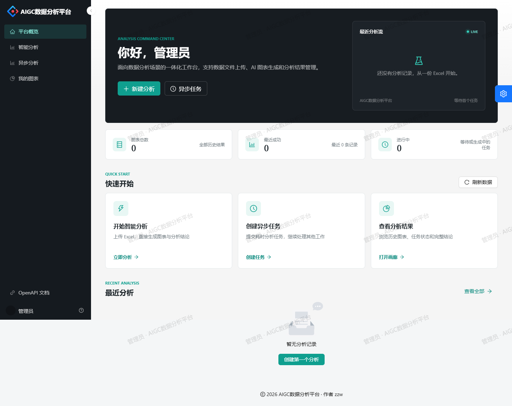
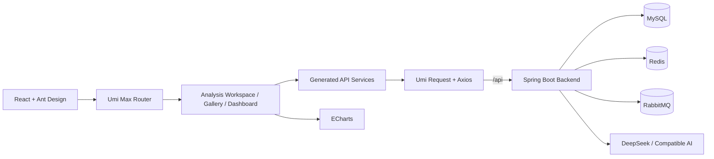
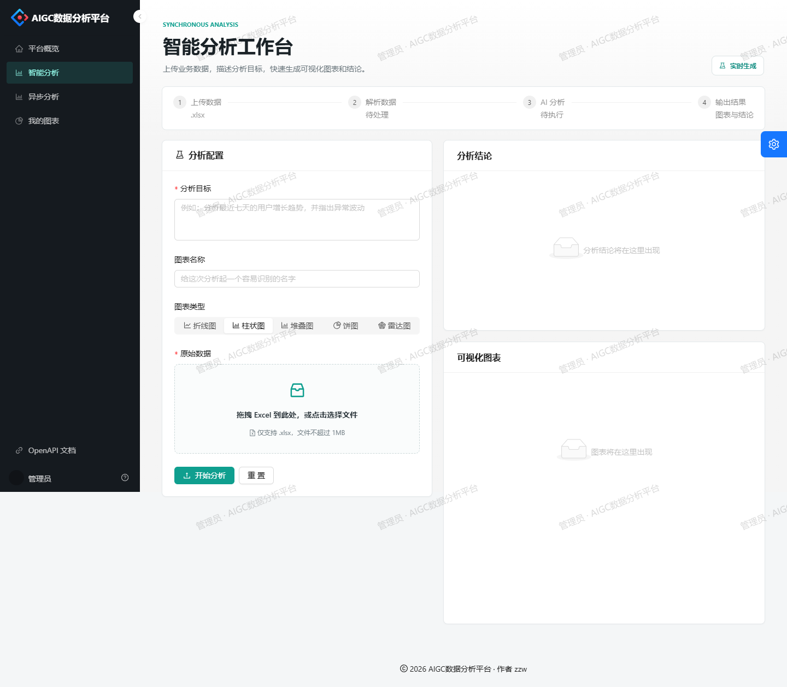

<p align="center">
  
</p>

<h1 align="center">AIGC Data Analysis Platform · Frontend</h1>

<p align="center">
  A production-oriented React workspace for AI-assisted Excel analysis, ECharts visualization, and analysis result management.
</p>

<p align="center">
  English | <a href="README.zh-CN.md">简体中文</a>
</p>

<p align="center">
  <a href="https://github.com/znnw/aigc-data-analysis-platform/actions/workflows/frontend-ci.yml">
    
  </a>
  
  
  
  
  
  
</p>



## Overview

This frontend belongs to the **AIGC Data Analysis Platform** monorepo. It provides a complete browser workflow for uploading Excel files, submitting AI analysis tasks, rendering ECharts visualizations, and reviewing historical analysis results.

The application is designed around three concerns:

- **Operational clarity**: dense, responsive screens for repeated analysis work.
- **Reliable integration**: explicit API error handling, session-based authentication, and safe chart rendering.
- **Presentation quality**: a consistent visual system, responsive layouts, and focused motion.

The frontend is located in `frontend/` and communicates with the Spring Boot backend through the same-origin `/api` path.

## Highlights

- Session-based login, registration, logout, and route protection.
- Synchronous AI analysis with immediate chart and conclusion rendering.
- Asynchronous analysis with automatic status polling.
- Searchable chart gallery with pagination and a detail drawer.
- Safe ECharts rendering that isolates malformed chart payloads per record.
- Unified request error handling without duplicate notifications.
- Downloadable and fullscreen ECharts output.
- Responsive desktop, tablet, and mobile layouts.
- Dark navigation shell, consistent status semantics, and a reusable design token layer.
- OpenAPI documentation entry integrated into the workspace navigation.

## Tech Stack

| Area | Technology | Version | Purpose |
| --- | --- | --- | --- |
| UI runtime | React | 18.2 | Component model and concurrent rendering |
| Application framework | Umi Max | 4.0.52 | Routing, layout, request, access, build pipeline |
| Component system | Ant Design | 5.2 | Forms, feedback, navigation, overlays |
| Pro components | Ant Design Pro Components | 2.3.57 | `ProLayout`, `PageContainer`, login form |
| Visualization | Apache ECharts | 5.4.3 | Generated analytical charts |
| React ECharts bridge | echarts-for-react | 3.0.2 | ECharts lifecycle integration |
| Language | TypeScript | 4.9.5 | Static typing and API contracts |
| Styling | Less | Umi managed | Global design tokens and responsive rules |
| HTTP | Umi Request / Axios | Umi managed | Cookie-aware REST requests |
| Build | Webpack + MFSU | Umi managed | Development and production bundling |
| Package manager | pnpm | 7.x | Reproducible dependency installation |
| CI | GitHub Actions | — | Type check, lint, and production build |

## Architecture



### Request flow

1. The browser sends cookie-aware requests to `/api/**`.
2. In development, Umi proxies `/api` to `http://127.0.0.1:8081`.
3. The shared request layer validates the backend `code`.
4. Non-zero codes are converted into a single `BizError` and displayed once.
5. Pages handle loading, empty, failure, and success states locally.

### Response contract

```json
{
  "code": 0,
  "data": {},
  "message": "ok"
}
```

`code === 0` indicates success. Authentication relies on the backend session cookie, so requests are configured with `withCredentials: true`.

## Screens

### Analysis workbench



### Available routes

| Route              | Purpose                                     |
| ------------------ | ------------------------------------------- |
| `/user/login`      | User login                                  |
| `/user/register`   | User registration                           |
| `/welcome`         | Analysis command center and recent activity |
| `/add_chart`       | Synchronous AI analysis                     |
| `/add_chart_async` | Asynchronous analysis and live task polling |
| `/my_chart`        | Searchable analysis gallery                 |
| `/admin`           | Administrator-only workspace                |

## Project Structure

```text
frontend/
├── config/                 # Umi routes, proxy, theme, and OpenAPI config
├── docs/screenshots/       # README screenshots
├── public/                 # Static assets served as-is
├── src/
│   ├── components/         # Shared layout, safe chart, navigation components
│   ├── pages/              # Route-level pages
│   ├── services/aigc/      # Generated API clients and types
│   ├── utils/              # Parsing and normalization helpers
│   ├── app.tsx             # Runtime layout and initial state
│   ├── global.less         # Design system and responsive styles
│   └── requestConfig.ts    # Shared request and error policy
├── .env.example
├── package.json
├── pnpm-lock.yaml
├── tsconfig.json
└── start-project.ps1       # Windows local launcher
```

## Getting Started

### Prerequisites

- Node.js 18+
- pnpm 7.x
- A running backend on `http://127.0.0.1:8081`
- MySQL and Redis for the backend
- RabbitMQ only when exercising the MQ-based backend endpoint

### Install

```bash
cd frontend
corepack enable
corepack prepare pnpm@7.33.7 --activate
pnpm install
```

### Configure

The default development configuration uses the Umi proxy and does not require an environment file:

```text
Browser -> http://localhost:8000/api -> http://127.0.0.1:8081/api
```

For a separately hosted API, create `.env.local`:

```dotenv
API_BASE_URL=http://localhost:8081
```

When `API_BASE_URL` is set directly, the backend must allow credentialed CORS requests.

### Run

```bash
pnpm dev
```

Open `http://localhost:8000`.

On Windows, the included launcher can prepare Node, MySQL, the backend JAR, and the frontend:

```powershell
.\start-project.ps1
```

The local admin credentials used by the development dataset are:

```text
admin / admin123456
```

## Environment Variables

| Variable | Default | Description |
| --- | --- | --- |
| `API_BASE_URL` | empty | Optional absolute backend origin; empty keeps `/api` same-origin |
| `REACT_APP_ENV` | `dev` | Selects the proxy profile from `config/proxy.ts` |
| `PORT` | `8000` | Development server port |
| `MOCK` | `none` in `start:dev` | Disables mock mode |
| `BROWSER` | unset | Controls automatic browser opening |

## Scripts

| Command        | Description                                |
| -------------- | ------------------------------------------ |
| `pnpm dev`     | Start the development server without mocks |
| `pnpm start`   | Start Umi in development mode              |
| `pnpm build`   | Create the production bundle in `dist/`    |
| `pnpm tsc`     | Run TypeScript checks                      |
| `pnpm lint:js` | Run ESLint                                 |
| `pnpm lint`    | Run ESLint, Prettier check, and TypeScript |
| `pnpm preview` | Build and preview on port 8000             |

## Quality and Reliability

- `pnpm tsc` and `pnpm build` are required CI checks.
- Generated API types are consumed through the service layer.
- Long backend identifiers are preserved as strings.
- Malformed ECharts JSON is isolated by a per-card error boundary.
- Synchronous uploads accept `.xlsx`; asynchronous uploads accept `.xlsx` and `.xls`, matching backend constraints.
- Async result polling stops on `succeed` or `failed`.
- Mobile layouts are verified at a 390 px viewport without horizontal overflow.

## Deployment

Build the static bundle:

```bash
pnpm build
```

Deploy the contents of `dist/` to a static host or CDN. The hosting layer must:

1. Proxy `/api/**` to the Spring Boot service.
2. Fall back to `index.html` for client-side routes.
3. Preserve session cookies for authenticated requests.

No production proxy is embedded in the frontend bundle because static files cannot proxy API traffic themselves.

## Repository Layout

This repository keeps the backend service at the repository root and the frontend in `frontend/`.

For developers who maintain the frontend in a separate local directory, use the repository sync helper:

```powershell
powershell -ExecutionPolicy Bypass -File scripts/sync-frontend.ps1 -Source D:\path\to\frontend
```

The helper copies source files into `frontend/` without touching the original local directory.

## Contributing

1. Create a focused branch.
2. Keep backend contracts stable or document any required API change.
3. Run `pnpm tsc`, `pnpm lint:js`, and `pnpm build`.
4. Include screenshots for visible UI changes.
5. Open a pull request using the repository template.
