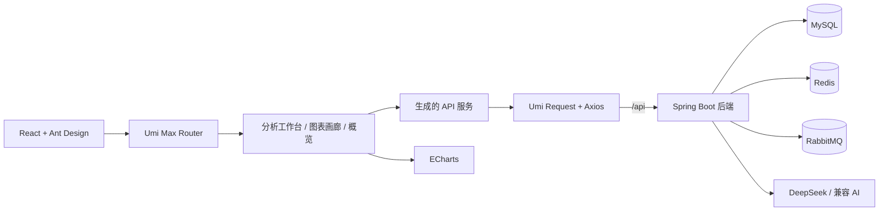

<p align="center">
  
</p>

<h1 align="center">AIGC 智能数据分析平台 · 前端</h1>

<p align="center">
  面向 AI 辅助 Excel 分析、ECharts 可视化和分析结果管理的 React 专业工作台。
</p>

<p align="center">
  <a href="README.md">English</a> | 简体中文
</p>

<p align="center">
  
  
  
  
  
  
</p>


## 项目简介

本前端属于 **AIGC 智能数据分析平台** 单仓库项目，提供从 Excel 上传、AI 分析任务提交、ECharts 图表渲染到历史结果管理的完整浏览器工作流。

项目围绕三个目标设计：

- **操作清晰**：面向重复分析工作的紧凑、响应式界面。
- **对接可靠**：明确的 API 错误处理、基于 Session 的登录态和安全图表渲染。
- **展示专业**：统一的视觉系统、响应式布局和克制的动效。

前端位于仓库的 `frontend/` 目录，通过同源 `/api` 路径与 Spring Boot 后端通信。

## 核心特性

- 基于 Session 的登录、注册、退出和路由保护。
- 同步 AI 分析，完成后立即展示图表和分析结论。
- 异步分析任务提交，并自动轮询执行状态。
- 支持名称搜索、分页和详情抽屉的图表画廊。
- 单条非法图表数据隔离，不会导致整页崩溃。
- 统一请求错误处理，避免重复错误提示。
- ECharts 图表下载与全屏查看。
- 桌面、平板和移动端响应式适配。
- 深色导航框架、统一状态语义和可复用设计变量。
- 工作台内集成 OpenAPI 文档入口。

## 技术栈

| 分类           | 技术                      | 版本     | 用途                                   |
| -------------- | ------------------------- | -------- | -------------------------------------- |
| UI 运行时      | React                     | 18.2     | 组件模型与并发渲染                     |
| 应用框架       | Umi Max                   | 4.0.52   | 路由、布局、请求、权限与构建           |
| 组件体系       | Ant Design                | 5.2      | 表单、反馈、导航与浮层                 |
| Pro 组件       | Ant Design Pro Components | 2.3.57   | `ProLayout`、`PageContainer`、登录表单 |
| 数据可视化     | Apache ECharts            | 5.4.3    | AI 生成的分析图表                      |
| React 图表桥接 | echarts-for-react         | 3.0.2    | ECharts 生命周期集成                   |
| 编程语言       | TypeScript                | 4.9.5    | 静态类型与接口契约                     |
| 样式           | Less                      | Umi 管理 | 全局设计变量与响应式规则               |
| HTTP           | Umi Request / Axios       | Umi 管理 | 携带 Cookie 的 REST 请求               |
| 构建           | Webpack + MFSU            | Umi 管理 | 开发与生产构建                         |
| 包管理         | pnpm                      | 7.x      | 可复现依赖安装                         |

## 系统架构



### 请求链路

1. 浏览器向 `/api/**` 发起携带 Cookie 的请求。
2. 开发环境由 Umi 将 `/api` 代理到 `http://127.0.0.1:8081`。
3. 统一请求层校验后端 `code`。
4. 非零 `code` 转换为单个 `BizError`，只展示一次。
5. 页面分别处理加载、空状态、失败和成功状态。

### 响应结构

```json
{
  "code": 0,
  "data": {},
  "message": "ok"
}
```

`code === 0` 表示成功。登录态依赖后端 Session Cookie，因此请求配置启用了 `withCredentials: true`。

## 页面预览

### 智能分析工作台


### 路由说明

| 路由               | 用途                 |
| ------------------ | -------------------- |
| `/user/login`      | 用户登录             |
| `/user/register`   | 用户注册             |
| `/welcome`         | 分析指挥台与最近记录 |
| `/add_chart`       | 同步 AI 分析         |
| `/add_chart_async` | 异步分析与任务轮询   |
| `/my_chart`        | 可搜索的分析图表画廊 |
| `/admin`           | 管理员工作区         |

## 目录结构

```text
frontend/
├── config/                 # Umi 路由、代理、主题和 OpenAPI 配置
├── docs/screenshots/       # README 截图资源
├── public/                 # 原样提供的静态资源
├── src/
│   ├── components/         # 布局、安全图表和导航组件
│   ├── pages/              # 路由页面
│   ├── services/aigc/      # 生成的 API 客户端和类型
│   ├── utils/              # 解析和归一化工具
│   ├── app.tsx             # 运行时布局和初始状态
│   ├── global.less         # 设计系统与响应式样式
│   └── requestConfig.ts    # 统一请求与错误策略
├── .env.example
├── package.json
├── pnpm-lock.yaml
├── tsconfig.json
└── start-project.ps1       # Windows 本地启动脚本
```

## 本地运行

### 环境要求

- Node.js 18+
- pnpm 7.x
- 后端运行于 `http://127.0.0.1:8081`
- 后端需要 MySQL 和 Redis
- 仅当测试 MQ 异步接口时需要 RabbitMQ

### 安装依赖

```bash
cd frontend
corepack enable
corepack prepare pnpm@7.33.7 --activate
pnpm install
```

### 配置后端地址

默认开发配置使用 Umi 代理，无需额外环境文件：

```text
浏览器 -> http://localhost:8000/api -> http://127.0.0.1:8081/api
```

如果后端独立部署，可创建 `.env.local`：

```dotenv
API_BASE_URL=http://localhost:8081
```

直接设置 `API_BASE_URL` 时，后端必须允许携带凭据的跨域请求。

### 启动前端

```bash
pnpm dev
```

访问 `http://localhost:8000`。

Windows 下也可以使用仓库内启动脚本准备 Node、MySQL、后端 JAR 和前端：

```powershell
.\start-project.ps1
```

本地开发数据中的管理员账号为：

```text
admin / admin123456
```

## 环境变量

| 变量            | 默认值                  | 说明                                      |
| --------------- | ----------------------- | ----------------------------------------- |
| `API_BASE_URL`  | 空                      | 可选的后端绝对地址；为空时使用同源 `/api` |
| `REACT_APP_ENV` | `dev`                   | 选择 `config/proxy.ts` 中的代理配置       |
| `PORT`          | `8000`                  | 开发服务器端口                            |
| `MOCK`          | `start:dev` 中为 `none` | 关闭 Mock 模式                            |
| `BROWSER`       | 未设置                  | 控制是否自动打开浏览器                    |

## 常用命令

| 命令           | 说明                                    |
| -------------- | --------------------------------------- |
| `pnpm dev`     | 启动无 Mock 的开发服务器                |
| `pnpm start`   | 以 Umi 开发模式启动                     |
| `pnpm build`   | 构建生产产物到 `dist/`                  |
| `pnpm tsc`     | 执行 TypeScript 检查                    |
| `pnpm lint:js` | 执行 ESLint                             |
| `pnpm lint`    | 执行 ESLint、Prettier 检查和 TypeScript |
| `pnpm preview` | 构建并在 8000 端口预览                  |

## 质量与可靠性

- 发布前执行 `pnpm tsc`、`pnpm lint:js` 和 `pnpm build`。
- 页面通过服务层消费生成的 API 类型。
- 后端长整型标识符以字符串形式保留。
- 非法 ECharts JSON 由单卡片错误边界隔离。
- 同步上传接受 `.xlsx`，异步上传接受 `.xlsx` 和 `.xls`，与后端约束一致。
- 异步轮询在 `succeed` 或 `failed` 状态停止。
- 已在 390 px 移动端视口验证无横向溢出。

## 构建与部署

构建静态产物：

```bash
pnpm build
```

将 `dist/` 部署到静态服务器或 CDN。托管层必须：

1. 将 `/api/**` 反向代理到 Spring Boot 服务。
2. 对客户端路由回退到 `index.html`。
3. 为认证请求保留 Session Cookie。

前端产物本身不能提供 API 代理，因此生产环境必须由 Nginx、网关或托管平台完成转发。

## 仓库结构

本仓库后端保留在根目录，前端独立存放于 `frontend/`。

如果继续在另一个本地目录维护前端源码，可以使用仓库同步脚本：

```powershell
powershell -ExecutionPolicy Bypass -File scripts/sync-frontend.ps1 -Source D:\path\to\frontend
```

同步脚本只复制源码到 `frontend/`，不会移动或修改原目录。

## 贡献指南

1. 创建范围明确的开发分支。
2. 保持后端接口契约稳定，如有变更需同步说明。
3. 提交前执行 `pnpm tsc`、`pnpm lint:js` 和 `pnpm build`。
4. UI 变更请附带桌面和移动端截图。
5. 使用仓库 PR 模板提交变更。
